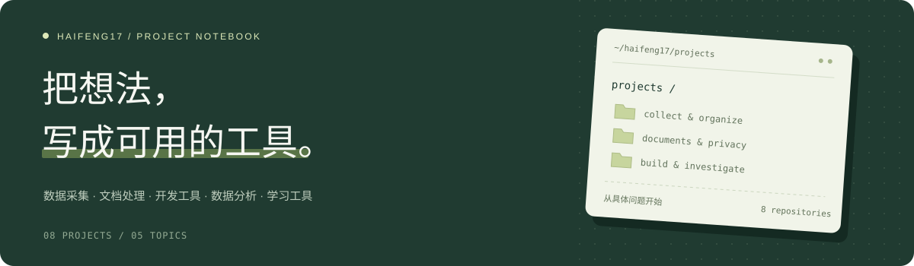

<b>数据采集 · 文档处理 · 开发工具 · 数据分析 · 学习工具</b>

你好，我是 haifeng17。这里整理了我的 8 个项目，从采集、整理，到复核与分析。

<h2 align="center"><a href="https://haifeng17.github.io/haifeng17/">浏览完整项目网页 ↗</a></h2>

## 项目一览

<table>
<tr>
<td width="50%" valign="top">

### 📦 [Smart Collector](https://github.com/haifeng17/smart-collector)

本机单用户商品采集工具，支持规则配置、任务管理、数据质量检查及图片、附件导出。

`数据采集` · `本机工具`

</td>
<td width="50%" valign="top">

### 📄 [TraceForge](https://github.com/haifeng17/traceforge)

离线优先的文档处理工具，支持敏感信息扫描、人工复核、脱敏副本和审计记录。具体能力受文件格式限制。

`文档处理` · `人工复核`

</td>
</tr>
<tr>
<td width="50%" valign="top">

### 🔎 [Refcheck Lab](https://github.com/haifeng17/refcheck-lab)

在不同 Git 提交上运行同一组检查，比较结果并定位回归或修复开始出现的版本。

`开发工具` · `版本比较`

</td>
<td width="50%" valign="top">

### 📊 [餐饮经营分析](https://github.com/haifeng17/restaurant-analytics)

面向多门店的经营分析应用，支持数据导入、销售看板、成本库存分析及报表导出，附带演示数据。

`数据分析` · `经营看板`

</td>
</tr>
<tr>
<td width="50%" valign="top">

### 🗂️ [工业品采集工具](https://github.com/haifeng17/20260710)

面向工业品站点的 Python 采集程序，提供通用规则入口和多个站点适配脚本。

`数据采集` · `Python`

</td>
<td width="50%" valign="top">

### 📈 [WQ 因子研究工作台](https://github.com/haifeng17/wq-factor-backtest)

用于数据集字段整理、模板实验、回测调度和研究记录管理的本地工作台。完整研究流程仍在完善。

`数据分析` · `因子研究`

</td>
</tr>
<tr>
<td width="50%" valign="top">

### 📖 [张弓言语智能体](https://github.com/haifeng17/zhanggong-yanyu)

单文件 HTML 言语学习工具，提供图片裁剪、语音输入和可配置的在线模型接口。

`学习工具` · `HTML`

</td>
<td width="50%" valign="top">

### 💻 [GitHub Desktop 练习](https://github.com/haifeng17/desktop-tutorial)

GitHub Desktop 入门练习仓库。

`开发工具` · `入门练习`

</td>
</tr>
</table>

这些项目目前均为私有仓库。本页展示项目简介，访问源码需要对应仓库权限。详细使用方法与能力边界以各仓库说明为准。
